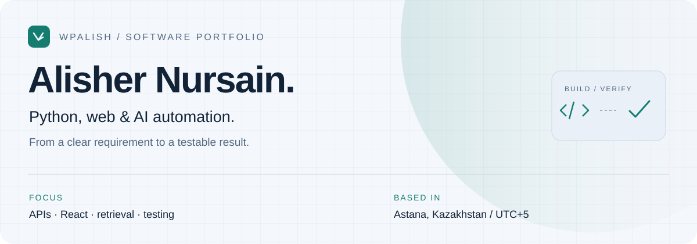

<picture>
  <source media="(prefers-color-scheme: dark)" srcset="assets/header-dark.svg">
  <source media="(prefers-color-scheme: light)" srcset="assets/header-light.svg">
  
</picture>

  <a href="#selected-work">Selected work</a> &nbsp; / &nbsp;
  <a href="case-studies/README.md">Engineering notes</a> &nbsp; / &nbsp;
  <a href="https://wpalish.github.io/ai-studio/">Concept portfolio</a> &nbsp; / &nbsp;
  <a href="mailto:alisher.nursain@gmail.com">Contact</a>

I build Python and TypeScript/React projects, with a focus on **APIs, automation and AI-assisted applications**. My portfolio brings together source code, architectural decisions and reproducible checks.

Based in **Astana, Kazakhstan**. Computing undergraduate at **Coventry University Kazakhstan** (2025–2029 expected), with **3+ years of self-directed programming**. I am looking for my first professional Junior role and well-scoped paid projects.

## Selected work

<table>
<tr>
<td width="50%" valign="top">
<h3>01 / ASHYQ Apply</h3>

<b>Evidence-led admissions software</b>

Python backend and React interface for university and scholarship discovery. Explicit requirement states and a durable job queue make uncertainty and background work visible.

<code>Python</code> <code>TypeScript</code> <code>React</code> <code>SQLAlchemy</code>

<a href="https://github.com/wpalish/ashyq-apply">Source ↗</a> · <a href="case-studies/ashyq-apply.md">Architecture &amp; scope</a>

Collaborative project · AI-assisted development

</td>
<td width="50%" valign="top">
<h3>02 / Context Platform</h3>

<b>Testable calculation modules</b>

Building-envelope, climate and life-cycle cost calculations. Tests cover invalid inputs, replacement horizons and sustained break-even behaviour.

<code>Python</code> <code>Data modelling</code> <code>pytest</code>

<a href="https://github.com/wpalish/context-platform">Source ↗</a> · <a href="case-studies/context-platform.md">Model &amp; verification</a>

67 calculation-module tests passed locally · 21 Oct 2026

</td>
</tr>
<tr>
<td width="50%" valign="top">
<h3>03 / Alēm Expert Router</h3>

<b>Explainable resource assignment</b>

Skill filters and capacity constraints feed a global assignment solver. Results retain reasons for matches and unassigned requests.

<code>Python</code> <code>Algorithms</code> <code>Pydantic</code> <code>pytest</code>

<a href="https://github.com/wpalish/alem-expert-router">Source ↗</a> · <a href="case-studies/alem-expert-router.md">Trade-offs &amp; tests</a>

19 matching / solver tests passed locally · 21 Oct 2026

</td>
<td width="50%" valign="top">
<h3>04 / Petrel RAG</h3>

<b>A retrieval systems exploration</b>

Code for dense/sparse retrieval and reranking, with local RU/KZ language-routing checks. A useful starting point for a bounded retrieval evaluation.

<code>Python</code> <code>RAG</code> <code>Qdrant</code> <code>Docker</code>

<a href="https://github.com/wpalish/petrel-rag-v5">Source ↗</a> · <a href="case-studies/petrel-rag.md">Pipeline &amp; validation limits</a>

8 language tests passed locally · retrieval quality not benchmarked

</td>
</tr>
</table>

Test counts describe selected modules, not full-system coverage. Each engineering note links the reviewed commit, test scope and remaining validation. These are portfolio projects; no paid-client results are implied.

## What I can contribute

| Area | A concrete starting scope |
| :--- | :--- |
| **Python & APIs** | A small integration or data-processing module, input validation and tests |
| **Web development** | A bounded React/TypeScript interface or a reproducible bug fix |
| **Automation & data** | A repeatable file-to-report workflow with documented checks |
| **AI applications** | A retrieval prototype with a defined evaluation set and explicit limitations |

I use AI-assisted tools for development and review. For client work, the permitted tools, data handling and acceptance criteria need to be agreed before implementation.

## Engineering approach

**Understand the requirement → isolate the logic → test edge cases → document the result.**

The [engineering notes](case-studies/README.md) show the decisions worth discussing in an interview: why unknown evidence needs its own state, where a greedy assignment fails, and how to distinguish a passing unit test from an evaluated system.

**Current toolkit:** Python · TypeScript · React · Git · pytest. Project-specific technologies and their validation scope are listed alongside the source.

---

**Let's discuss a concrete task.** [Email](mailto:alisher.nursain@gmail.com) · [Concept Work / Synthetic Data portfolio](https://wpalish.github.io/ai-studio/) · [Astana Hub profile](https://astanahub.com/account/v2/user/832790/profile/about/)

Concept demonstrations are labelled separately from repository work. My public projects include collaborative and AI-assisted development; repository complexity is not a claim of commercial seniority.
