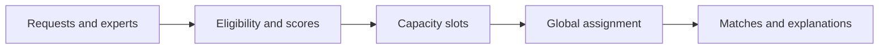

# Alēm Router / Prefer a global assignment to a greedy match

[← Profile](../README.md) · [Source repository](https://github.com/wpalish/alem-expert-router)

## The problem

Assigning the locally best expert to the first request can leave another request with no qualified expert. Availability, skills and remaining capacity must be considered together.

## Design worth discussing

1. Filter incompatible pairs and score eligible candidates.
2. Expand each expert's remaining capacity into assignable slots.
3. Solve the assignment globally, with request-priority weighting.
4. Return match explanations and explicit reasons for unassigned requests.

The code distinguishes strict skill coverage from a penalised partial-coverage fallback. This makes the fallback visible for review rather than presenting every result as an exact match.



[Matching and capacity logic](https://github.com/wpalish/alem-expert-router/blob/a38f8fe8efec55d0ccf74847388a745721cc6429/app/matching.py) · [Assignment solver](https://github.com/wpalish/alem-expert-router/blob/a38f8fe8efec55d0ccf74847388a745721cc6429/app/assignment_solver.py) · [Solver tests](https://github.com/wpalish/alem-expert-router/blob/a38f8fe8efec55d0ccf74847388a745721cc6429/tests/test_solver.py)

## Verification

**19 matching/solver tests passed locally on 21 October 2026**, Python 3.12 / pytest 9.1.1:

```sh
python -m pytest tests/test_solver.py tests/test_matching.py -q
```

The test selection checks deterministic matching behaviour and solver cases. It does not establish fairness for real people, API availability, LLM behaviour or measured business outcomes. Real assignments would need an agreed policy and human review.

## Review scope

Reviewed source: [`a38f8fe8efec`](https://github.com/wpalish/alem-expert-router/tree/a38f8fe8efec55d0ccf74847388a745721cc6429). Public main reference checked on 21 October 2026. Portfolio review and selected local checks are not production acceptance, certification or a paid-client reference. Development includes AI-assisted tooling; no sole authorship of every source line is claimed.
