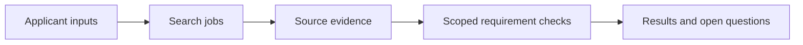

# ASHYQ Apply / Make uncertainty explicit

[← Profile](../README.md) · [Source repository](https://github.com/wpalish/ashyq-apply)

## The problem

University requirements change, and a missing source is different from a confirmed requirement an applicant does not meet. An admissions interface needs to preserve that distinction while searches and background jobs run.

## Design worth discussing

- The domain evaluator uses explicit statuses and scoped evidence. Unknown or unread requirements should not silently become a negative eligibility verdict.
- The job store exposes leases, retries, cancellation and idempotency. Ownership checks fence writes after a worker's lease has been reclaimed.
- A Python backend and TypeScript/React frontend separate domain decisions from their presentation.

## Read the implementation

[Eligibility model and evaluator](https://github.com/wpalish/ashyq-apply/blob/1b2a554129f5744eb297848472f1c8fe8c7fde26/backend/app/domain/eligibility.py) · [Durable job store](https://github.com/wpalish/ashyq-apply/blob/1b2a554129f5744eb297848472f1c8fe8c7fde26/backend/app/jobs/store.py) · [Eligibility tests](https://github.com/wpalish/ashyq-apply/blob/1b2a554129f5744eb297848472f1c8fe8c7fde26/backend/tests/test_eligibility.py)

## Contribution context and validation

This is a **collaborative ASHYQ project**, with human and AI-assisted contributions. I present it as project experience, not sole authorship or employment tenure. The linked source supports a discussion of architecture; this portfolio check did **not** rerun the complete backend, PostgreSQL queue concurrency or authenticated end-to-end journey. Those need separate validation before a client deployment.

A sensible bounded task would be one requirement rule or queue edge case, with a failing reproduction, a focused change and relevant tests.

## Review scope

Reviewed source: [`1b2a554129f5`](https://github.com/wpalish/ashyq-apply/tree/1b2a554129f5744eb297848472f1c8fe8c7fde26). Public main reference checked on 21 October 2026. Portfolio review and selected local checks are not production acceptance, certification or a paid-client reference. Development includes AI-assisted tooling; no sole authorship of every source line is claimed.
