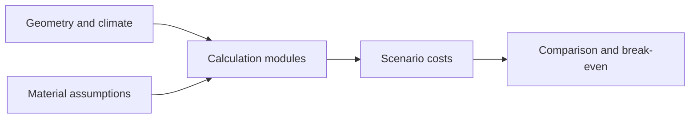

# Context Platform / Model the calculation before the interface

[← Profile](../README.md) · [Source repository](https://github.com/wpalish/context-platform)

## The problem

Comparing construction scenarios requires more than choosing the lowest initial cost: climate, envelope heat loss, component replacement and the analysis horizon change the result.

## Design worth discussing

The calculation layer separates geometry, material properties, climate inputs and life-cycle cost logic. Examples of meaningful edge cases:

- Non-positive thermal resistance is rejected.
- A replacement exactly at the analysis horizon is excluded.
- A temporary cost crossing is not accepted as a sustained break-even point.
- A colder-climate scenario increases the modelled heating demand.



[Life-cycle cost logic](https://github.com/wpalish/context-platform/blob/351b8a0b13ac041be6c3336dbb8b6cdacc068c3a/app/lcc.py) · [LCC edge-case tests](https://github.com/wpalish/context-platform/blob/351b8a0b13ac041be6c3336dbb8b6cdacc068c3a/tests/test_lcc.py)

## Verification

**67 tests passed locally on 21 October 2026** using Python 3.12 and pytest 9.1.1:

```sh
python -m pytest tests/test_lcc.py tests/test_climate.py tests/test_materials.py tests/test_compliance.py -q
```

The isolated review environment is not a reproduction of every production dependency. An attempted broader run including `test_recommendation.py` could not collect because FastAPI was absent from that environment; no recommendation/API test pass is claimed.

These checks exercise model behaviour, **not engineering certification, verified real-world energy savings or full web/API acceptance**. A client use case needs independently agreed assumptions and domain review.

## Review scope

Reviewed source: [`351b8a0b13ac`](https://github.com/wpalish/context-platform/tree/351b8a0b13ac041be6c3336dbb8b6cdacc068c3a). Public main reference checked on 21 October 2026. Portfolio review and selected local checks are not production acceptance, certification or a paid-client reference. Development includes AI-assisted tooling; no sole authorship of every source line is claimed.
