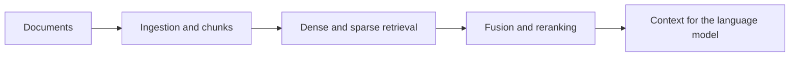

# Petrel RAG / Separate pipeline code from retrieval evidence

[← Profile](../README.md) · [Source repository](https://github.com/wpalish/petrel-rag-v5)

## The problem

An internal-document assistant needs to retrieve useful passages and handle Russian and Kazakh inputs. A pipeline diagram alone does not demonstrate answer quality.

## Architecture represented in the source



[RAG orchestration](https://github.com/wpalish/petrel-rag-v5/blob/37ec1129e9d1977bd173da7e9b7247dd3075d823/app/rag_engine.py) · [Ingestion](https://github.com/wpalish/petrel-rag-v5/blob/37ec1129e9d1977bd173da7e9b7247dd3075d823/app/ingestion.py) · [Language tests](https://github.com/wpalish/petrel-rag-v5/blob/37ec1129e9d1977bd173da7e9b7247dd3075d823/tests/test_lang.py)

## Verification and the next useful experiment

**8 language-routing tests passed locally on 21 October 2026** (Python 3.12):

```sh
python -m pytest tests/test_lang.py -q
```

These are heuristic language-routing checks, including empty input and RU/KZ examples. They do **not** establish retrieval relevance, model safety, factual answer quality or general language-detection accuracy. Qdrant, embedding/reranking models and live LLM calls were not exercised in this review.

A commercial pilot should first agree a permitted document sample, representative questions, answerability labels and measurable retrieval criteria. This portfolio repository is a technical exploration, not a claim of a completed paid Petrel engagement.

## Review scope

Reviewed source: [`37ec1129e9d1`](https://github.com/wpalish/petrel-rag-v5/tree/37ec1129e9d1977bd173da7e9b7247dd3075d823). Public main reference checked on 21 October 2026. Portfolio review and selected local checks are not production acceptance, certification or a paid-client reference. Development includes AI-assisted tooling; no sole authorship of every source line is claimed.
